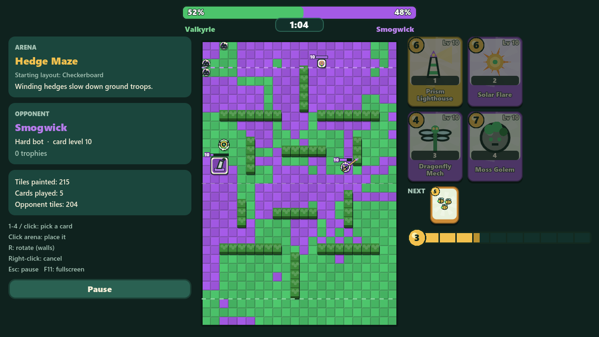
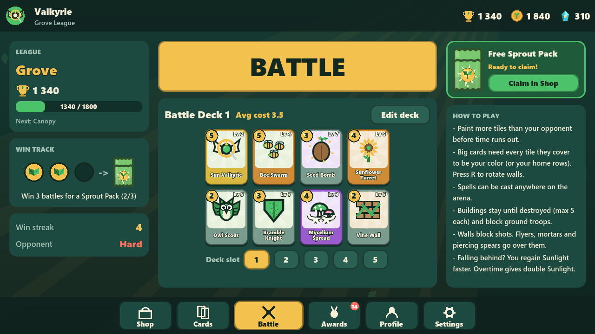
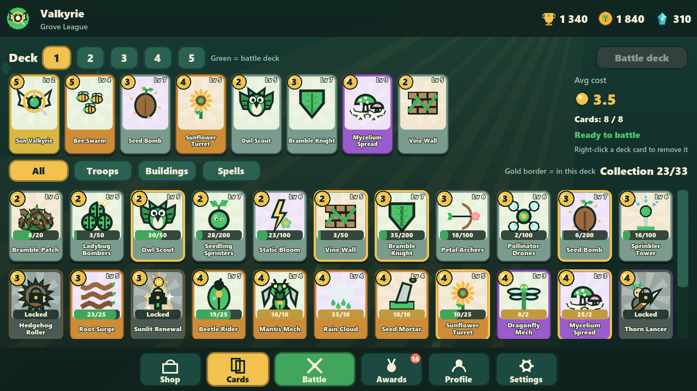
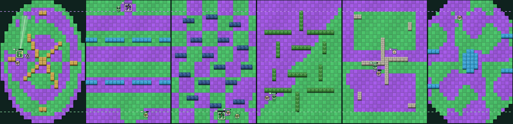
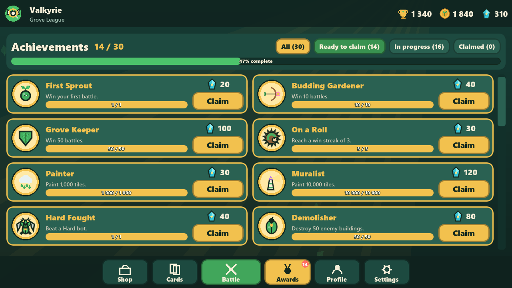

<p align="center">
  
</p>

<h1 align="center">Solarpunk Valkyrie</h1>

<p align="center">
  <b>A solarpunk territory-painting card battler for PC.</b><br>
  Paint the arena in your color, outsmart a clever bot, and grow the greenest deck in the garden.<br>
  Built with Godot 4.6.
</p>

<p align="center">
  
</p>

## What is it?

Two teams fight over a tiled arena. Your **Leaf Green** faces the **Smog Violet** of a polluting rival by default, and you can recolor both teams in Settings. Every troop, building and spell you play paints tiles:
- troops leave trails as they walk
- turrets spray paint droplets
- spells splash whole areas

When the timer runs out, **whoever has painted more of the arena wins**. Paint every tile and you win on the spot.

The game takes ideas from *Color Clash Arena* (painting territory) and *Clash Royale* (a Sunlight bar, a hand of 4 cards, a deck of 8). On top of that it adds:
- walls
- cards that take up several tiles
- permanent buildings
- a skill-first balance system

<p align="center">
  
  
</p>

## Features

- **33 cards:** 17 troops, 9 buildings and 7 spells. Each card has procedural vector art and its own way of painting.
  - Rarity changes how a card plays, not how strong it is. An automatic balancer tunes every card toward a 50% win rate.
- **6 arenas with walls:** Clockwork Garden, Twin Canals, Solar Farm, Hedge Maze, Pinwheel Plaza and Lotus Atrium.
  - Walls block placement, ground troops and shots.
  - Flyers, mortar shells and piercing spears go over them.
- **7 starting layouts:** Frames, Halves, Stripes, Checkerboard, Diagonal, Rings and Islands.
  - The arena and layout are picked at random each match.
  - Every layout starts at exactly 50-50.
- **A smart opponent** with four difficulties, from Easy to Brutal.
  - It counters your pushes, aims spells at the middle of groups, and punishes you when you're low on Sunlight.
  - In the final seconds it spends everything on the biggest paint swings.
- **Progression without paying:** Seeds, Sunshards, four pack tiers (Sprout, Bloom, Grove and Canopy) and card upgrades. Card levels only add +3% per level, so skill wins over grinding.
- **Leagues** from Seedbed to Solar Crown, plus win streaks and a win track that rewards packs.
- **30 achievements** that you claim for Sunshards.
- **5 deck slots,** and profiles with avatars and stats.
- **Settings** for team colors, volumes, mute, bot difficulty, match length, fullscreen (F11), damage numbers and screen shake.
- **Creative Mode,** a separate test save where every card is max level and money is unlimited, with optional infinite Sunlight.
- **No assets to download:** all art and all sound effects and music are generated in code.

<p align="center">
  
  <br><sub>The six arenas: Clockwork Garden, Twin Canals, Solar Farm, Hedge Maze, Pinwheel Plaza, Lotus Atrium</sub>
</p>

## How to play

| Action | Control |
|---|---|
| Pick a card | Click it, or press `1`–`4` |
| Place it | Click the arena, or drag the card onto it |
| Rotate (walls) | `R` |
| Cancel | Right-click |
| Pause | `Esc` |
| Fullscreen | `F11` |

### Rules
- **Time:** a match is 2:00 of regular time, then 0:30 of **overtime** with ×2 Sunlight. You can pick 1:30, 2:00 or 3:00 in Settings.
- **Sunlight:** you start with 5 and can hold up to 10. It refills over time and pays for cards.
- **Hand:** you hold 4 cards from your 8-card deck and can see the next one coming.
- **Placing troops and buildings:** each card covers a set number of tiles: 1×1, 2×1, 2×2, or 3×1 for walls. **Every tile it covers must be your color** or inside your **home rows**, the 3 rows behind your dashed line. Spells can go anywhere.
- **Buildings:**
  - They never decay. They only lose HP when attacked.
  - Solid buildings block ground troops, who walk around them.
  - Each side can have up to 5.
- **Collision:** troops can't share a tile. Ground troops and flyers don't collide with each other.
- **Comebacks:** if you fall behind on territory, your Sunlight refills up to 60% faster.

## The cards

| Type | Cards |
|---|---|
| **Troops** | Seedling Sprinters · Petal Archers · Bramble Knight · Pollinator Drones · Owl Scout · Ladybug Bombers · Beetle Rider · Bee Swarm · Mantis Mech · Hedgehog Roller · Dragonfly Mech · Thorn Lancer · Moss Golem · Solar Zeppelin · Sun Valkyrie · Glacier Gardener · Treant Guardian |
| **Buildings** | Sprinkler Tower · Vine Wall · Bramble Patch · Sunflower Turret · Seed Mortar · Greenhouse · Windmill · Bloom Fountain · Prism Lighthouse |
| **Spells** | Static Bloom · Seed Bomb · Root Surge · Sunlit Renewal · Rain Cloud · Mycelium Spread · Solar Flare |

To see any card's stats, open it in the **Cards** tab.

<p align="center">
  
</p>

## Running the game

**From source (Windows, macOS or Linux):**
1. Install **[Godot 4.6](https://godotengine.org/download)**, the standard build (not the .NET one).
2. Clone this repository.
3. In Godot, choose **Import**, select `project.godot`, then press **Play** (F5).

**On Windows**, you can also use the launchers in `launchers/`:
- `Play Solarpunk Valkyrie.bat` runs the game.
- `Open in Godot Editor.bat` opens the project in the editor.

Before using them, set the `GODOT` environment variable to your Godot executable, or edit the path inside the `.bat` files.

**Standalone `.exe`:** export it yourself (the command is below). If there's a build on the [Releases](https://github.com/UncertaintyNihilityOmega/Solarpunk-Valkyrie/releases) page, you can download that instead.

Saves are kept in your user data folder. On Windows that's `%APPDATA%\Godot\app_userdata\Solarpunk Valkyrie\`. To wipe them, use **Settings → Reset all saves**.

## For developers

```text
scripts/
  autoload/   game.gd (saves, decks, packs, leagues, achievements, settings) · sfx.gd (procedural audio)
  battle/     battle_sim.gd (rules, no rendering) · bot_ai.gd · arena_maps.gd · arena_view.gd · battle_screen.gd
  data/       card_db.gd (all card stats) · card_power.json (balancer output) · achievements.gd
  ui/         ui_kit.gd · card_view.gd · card_icons.gd (procedural art) · screens/ · popups
  tools/      balance_sim.gd (bot-vs-bot balance lab + auto-tuner) · rule_tests.gd
shaders/      arena_floor.gdshader
docs/         balance research, latest balance report, screenshots
```

The battle rules don't draw anything. That means the live game, the bot and the headless tools all run the exact same simulation. Useful commands (PowerShell; `$g` is your Godot **console** executable):

```powershell
# Rule regression tests
& $g --headless --path . -- --test
# Balance lab: 150 Hard-vs-Hard bot matches -> docs/balance-sim-latest.md
& $g --headless --path . -- --sim 150 [--diff 3,1] [--map hedge_maze]
# Auto-tune card power toward 50% win rates -> scripts/data/card_power.json
& $g --headless --path . -- --sim 150 --tune 4
# Screenshot QA (screens or an autoplayed battle)
& $g --path . -- --shot shot.png --screen cards
& $g --path . -- --shot shot.png --battle --map clockwork_garden --layout Rings --wait 10 --speed 2
# Export the Windows .exe
& $g --headless --path . --export-release "Windows Desktop" builds/SolarpunkValkyrie.exe
```

## Licence

**Code:** MIT. **Content:** CC BY 4.0. See [LICENSE](LICENSE) for the details.

Credit the work as *"Solarpunk Valkyrie by UncertaintyNihilityOmega"* with a link to this repository.

Solarpunk Valkyrie is an independent fan project inspired by *Color Clash Arena* (Voodoo) and *Clash Royale* (Supercell). It is not affiliated with or endorsed by either company.
